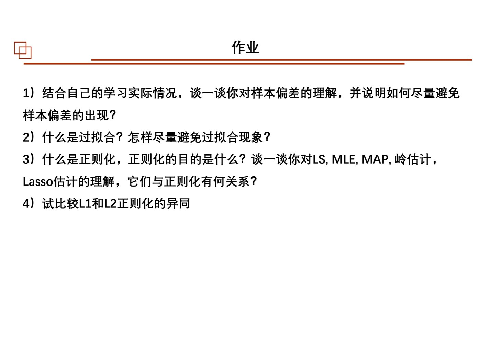
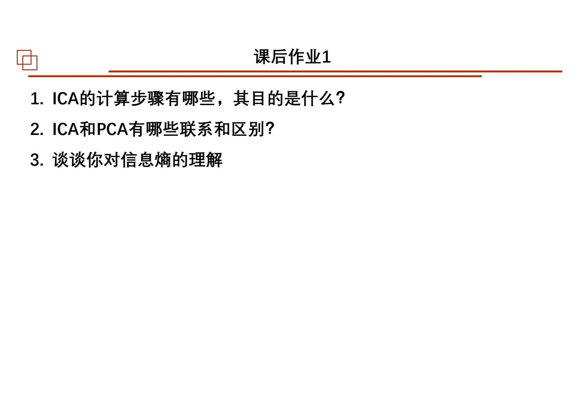
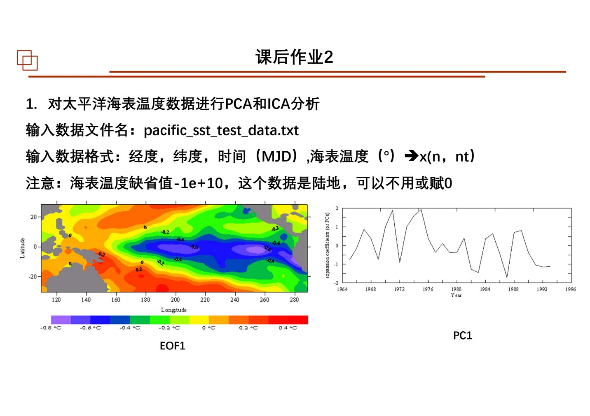
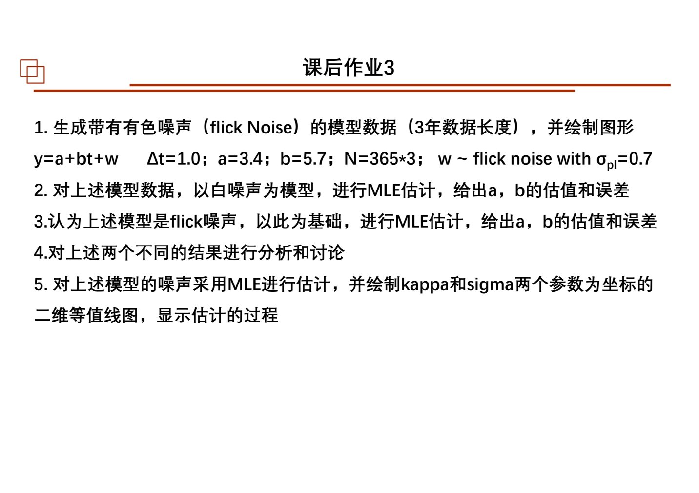
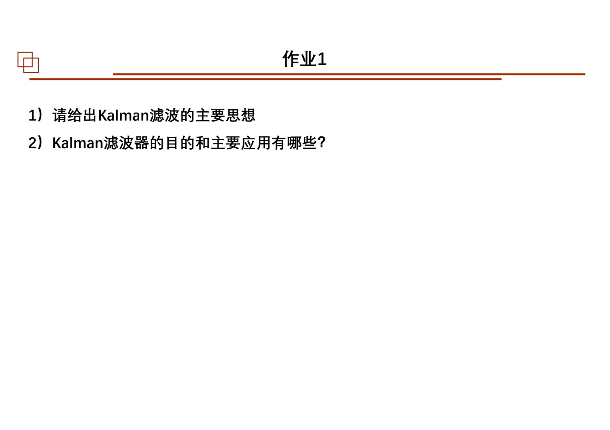
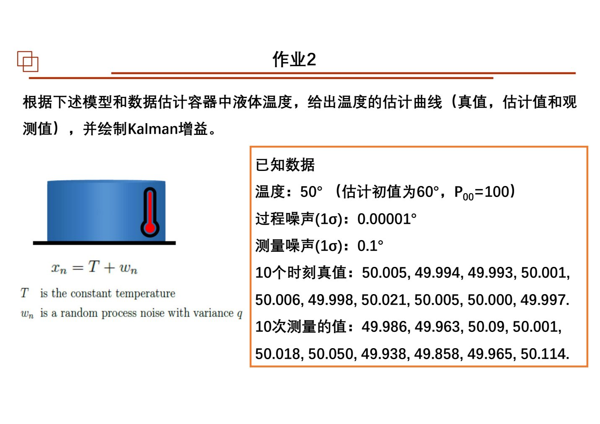
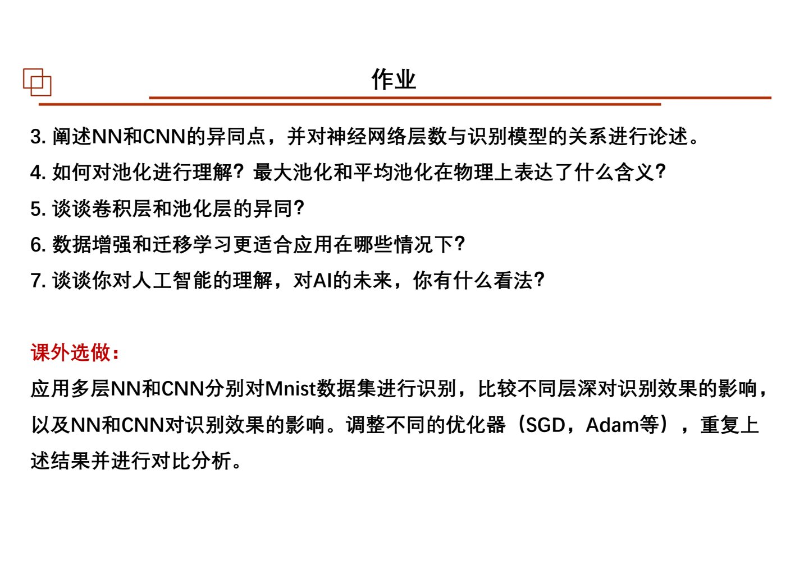
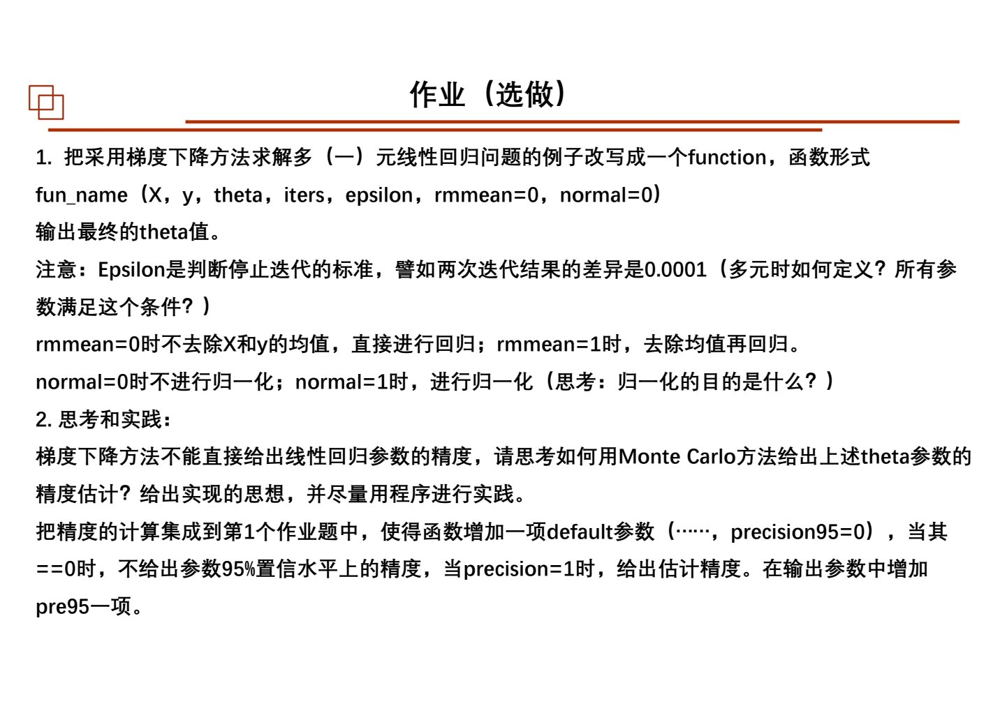
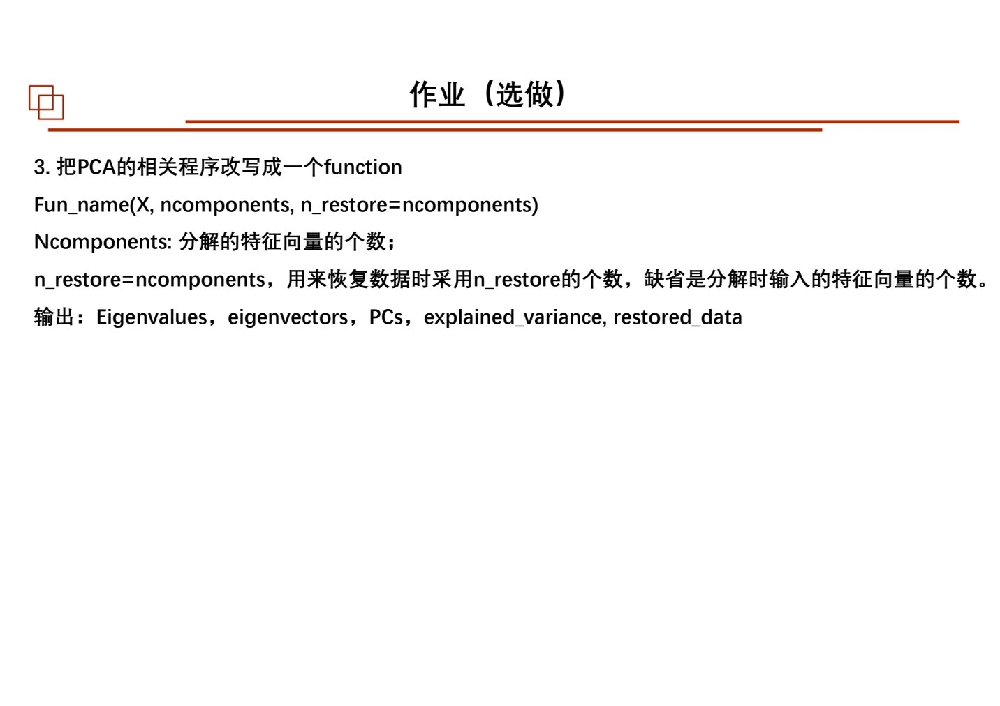

# 作业原页图对照

本页直接嵌入作业页原图，以便核对[文字转录](01_逐课作业原题.md)中的数学符号、图、数据和选做标记。第 01—08 次课为 2026 PDF，第 09—14 次课暂用 2025 PDF。

## 第 01 次课

### 第 89 页

### 第 90 页

## 第 02 次课

### 第 81 页

### 第 82 页

### 第 83 页

### 第 84 页

## 第 03 次课

### 第 100 页

### 第 101 页

### 第 102 页

### 第 103 页

## 第 04 次课

### 第 114 页

### 第 115 页

### 第 116 页

### 第 117 页

## 第 05 次课

### 第 101 页

### 第 102 页

### 第 103 页

## 第 06 次课

### 第 135 页

### 第 136 页

### 第 137 页

### 第 138 页

### 第 139 页

## 第 07 次课

### 第 124 页

### 第 125 页

### 第 126 页

### 第 127 页

## 第 08 次课

### 第 120 页

### 第 121 页

### 第 122 页

## 第 09 次课

### 第 104 页

## 第 10 次课

未发现独立作业页。

## 第 11 次课

### 第 87 页

### 第 88 页

### 第 89 页

## 第 12 次课

### 第 143 页

### 第 144 页

## 第 13 次课

### 第 159 页

### 第 160 页

## 第 14 次课

### 第 66 页

### 第 67 页

第 14 次课全部为选做；第 13 次课另含 MNIST 选做。实际提交要求以教师通知为准。
