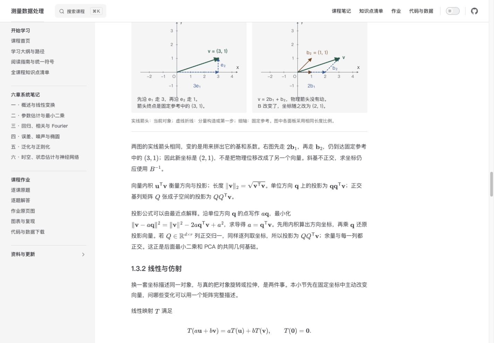
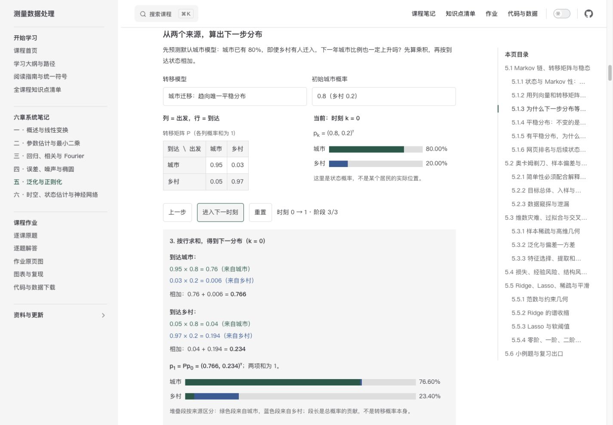
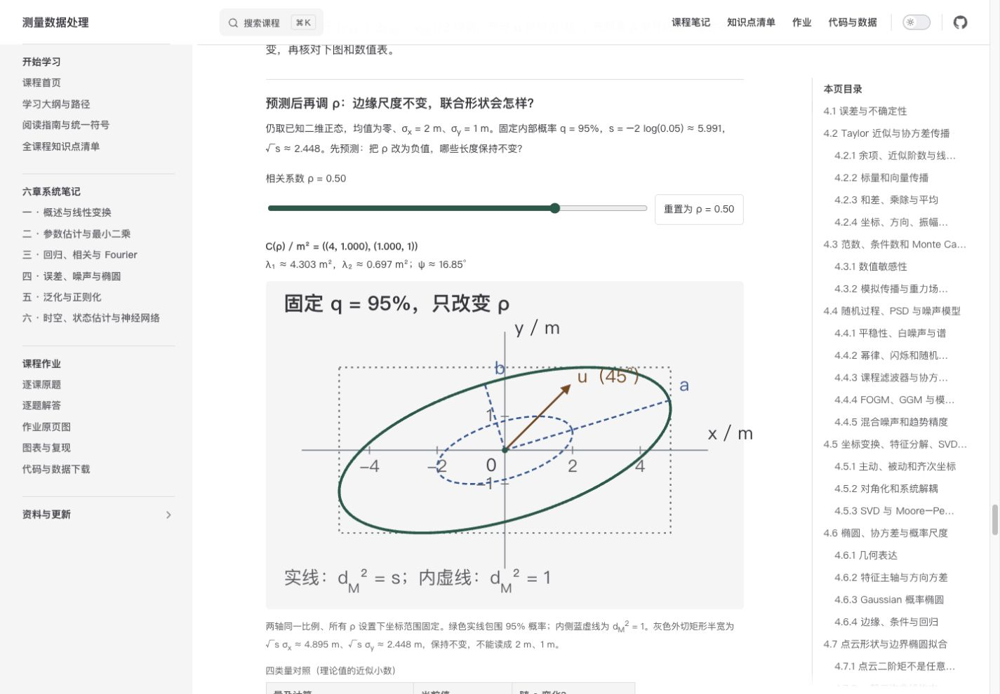

# 首批可视化试点：V01、V18、V14

日期：2026-10-15。依据 `planning/visualization-audit.md`，按用户指定顺序实施。本文保留首次本地试点验收记录；当时尚未推送或部署。用户确认后的发布状态以 Git 提交及 GitHub Pages 部署记录为准。

> **当前认知负荷重构见 [第 8 节](#cognitive-distill)**。第 1—7 节为此前试点和工程打磨记录；旧三阶段面板、数值表、12 项测试和旧预览端口均为历史状态，不能当作本轮界面说明。

## 1. 实施结果与阅读入口

| 试点 | 正文位置 / 新增锚点 | 实现与解决的困难 |
|---|---|---|
| V01 | 第一章 1.3.1 基变换数例后 `#v01-basis`；1.3.2 主动/被动说明后 `#v01-rotation`、`#v01-order` | 六幅静态 SVG 分为三组：同一物理向量的标准/斜基分量，固定轴转对象/固定对象转轴，SR/RS 的不同终点。无控件。 |
| V18 | 第五章 5.1.3 前两步数例后 `#v18-markov` | 三阶段“输入当前分布 → 各来源乘积 → 按到达状态求和”；前进、回退、重置，三矩阵预设及初分布选择。保留概率条、离散历史、长期对比表。 |
| V14 静态 | 第四章 4.6.2 方向方差证明后 `#v14-shape` | 已知协方差例：等比例轮廓、外切矩形、主轴及固定 45° 方向；对照坐标标准差、主轴标准差及投影方差。此处不提前把轮廓称为 95% 区域。 |
| V14 最小交互 | 第四章 4.6.3 概率尺度推导与 W06 澄清后 `#v14-probability` | 只开放相关系数。边际标准差、均值和内部概率固定；图形、矩阵、特征值、方向和数值表同步。对照内侧标准轮廓与外侧 95% 轮廓。 |

三个试点都在图前给出观察问题，图后解释数学规律，新增内容标作解释补充。没有增加教师考点声明。原有章节标题、锚点和正文保留；逐行对照 HEAD，三章原有非空行均按原顺序保留。本轮未改变覆盖索引、作业代码、数据、构建配置或依赖。

## 2. 数学模型与边界

### V01：先判断对象与基各自是否改变

- 标准表示 $\mathbf v=(3,1)^{\mathsf T}$，斜基 $B=\begin{pmatrix}1&1\\0&1\end{pmatrix}$。新坐标为 $(2,1)^{\mathsf T}$，由 $B\mathbf c=\mathbf v$ 重构。斜基不正交，不能把逆矩阵换成转置。
- 主动旋转 $R(\pi/2)\mathbf v=(-1,3)^{\mathsf T}$；被动将轴转 $90^\circ$，物理向量不动，新坐标 $R(-\pi/2)\mathbf v=(1,-3)^{\mathsf T}$。
- $S=\operatorname{diag}(2,1)$、输入 $(1,0)^{\mathsf T}$：$SR$ 得 $(0,1)^{\mathsf T}$，$RS$ 得 $(0,2)^{\mathsf T}$。图明确从右侧矩阵开始运算。
- 各面板保持相同比例与参考范围；不同线型标对象、构造与参考。没有同时移动对象和坐标轴。

### V18：过程是精确概率递推，不是居民模拟

- 采用正文列概率约定，$P_{ij}$ 的列是出发、行是到达，各列和为 $1$。来源贡献是 $P_{ij}p_{k,j}$，条形段长编码该乘积，而不是转移概率本身。
- 默认城市模型由 $(0.8,0.2)^{\mathsf T}$ 得到 $(0.766,0.234)^{\mathsf T}$ 和 $(0.73472,0.26528)^{\mathsf T}$。
- 城市平稳分布为 $(0.375,0.625)^{\mathsf T}$；交替链虽有唯一平稳分布，其他初值会交替；单位矩阵每个分布都平稳，但没有所有初值共同趋向的唯一平稳分布。交替链从 $(0.5,0.5)^{\mathsf T}$ 开始的特殊情形单独说明。
- 历史只画离散递推点，纵轴始终为 $[0,1]$，不作连续插值。较长时刻表可直接查看 $k=0,1,20,60$，不必手动点击到 60。
- 有限步表和图都不构成极限定理的证明；长期趋近不表示居民停止迁移。时刻上限为 $60$，不允许继续到 61。

### V14：W06 已处理，仅使用已知总体参数

已知模型为 $\mathbf X\sim N(\mathbf0,C(\rho))$，两坐标单位均为米，

$$
C(\rho)=\begin{pmatrix}4&2\rho\\2\rho&1\end{pmatrix}\,\mathrm m^2,
\qquad -0.95\le\rho\le0.95.
$$

均值和总体协方差是给定量。没有随机抽样，也没有用样本估计参数。

| 对象 | 含义及本图处理 |
|---|---|
| 坐标标准差 | $\sigma_x=2\,\mathrm m$、$\sigma_y=1\,\mathrm m$，始终固定。 |
| 主轴标准差 | $\sqrt{\lambda_1}$、$\sqrt{\lambda_2}$，单位米；由 $|\rho|$ 决定。 |
| 方向投影方差 | 固定单位方向 $\mathbf u=(1,1)^{\mathsf T}/\sqrt2$，$\mathbf u^{\mathsf T}C\mathbf u=(2.5+2\rho)\,\mathrm m^2$；开方才是标准差。图中棕箭头只标方向，长度不编码方差。 |
| 概率椭圆半轴 | 固定 $q=0.95$，$s=-2\log(1-q)\approx5.991464547$；半轴为 $\sqrt{s\lambda_j}$，不是 $s\sqrt{\lambda_j}$。 |
| 投影半宽 | $\sqrt{s}\sqrt{\mathbf u^{\mathsf T}C\mathbf u}$。坐标外切矩形半宽为 $\sqrt{s}\sigma_x$、$\sqrt{s}\sigma_y$，约 $4.895\,\mathrm m$、$2.448\,\mathrm m$。 |
| 射线半径 | $\sqrt{s/(\mathbf u^{\mathsf T}C^{-1}\mathbf u)}$，通常不是投影半宽。正文增补证明以防误读。 |

默认 $\rho=0.5$ 与正文 4.8 的 $C=\begin{pmatrix}4&1\\1&1\end{pmatrix}$ 对应，特征值 $(5\pm\sqrt{13})/2$，倾角约 $16.845^\circ$，95% 半轴约 $5.077\,\mathrm m$、$2.044\,\mathrm m$。改变相关性不改变边缘标准差，固定概率不代表固定椭圆形状或面积。

**W06 的依赖处理：** 第四章、`02_逐课作业解答.md` 的 L08 及 `03_图表与复现说明.md` 均补充了统计含义。旧 L08 图使用同一批 300 点的样本均值及样本协方差，是代入估计参数的形状图；不能无条件称为精确 95% 总体覆盖、均值置信或未来观测预测区域。没有重算或改写旧作业数据，也没有引入另一套有限样本椭圆组件。

核对依据：独立标准正态平方和的卡方关系及密度见 [NIST 卡方分布](https://www.itl.nist.gov/div898/handbook/eda/section3/eda3666.htm)；未知总体均值的 Hotelling 推断与置信椭圆见 [Penn State STAT 505 第七课](https://online.stat.psu.edu/stat505/Lesson07)。本试点不把后者公式用于已知参数模型。

范围限制：没有加入方向滑块、概率滑块、圆形/奇异分布预设、点云模拟或 3D。$|\rho|=1$ 时退化，组件拒绝求逆；固定的两个不同边缘方差使本模型不会出现特征值重合的圆形。概率属于整个内部，边界本身概率为零。

## 3. 工程与可访问性

- 新增文件集中在 `.vitepress/theme/visualizations/`。V01 SVG 有确定性生成脚本，V18/V14 用 Vue 与内联 SVG；没有新依赖，没有通用组件框架。
- SVG 的对象、轴、构造、主方向有线型、文字与数值辅助，不只靠颜色。使用站点颜色变量；深色模式另设描边与文字色，SVG 不依赖操作系统模式。
- V01 小屏由左右排列改为上下排列。交互控件可换行；大表只在表内横向滚动，不撑宽整页。SVG 保持等比例，图中文字随容器缩放。
- 原生按钮、下拉框和滑块支持键盘，有可见焦点；滑块步长 0.05，支持 Home/End/方向键，重置按钮始终可用。计算阶段通过礼貌播报区提示；相关系数在提交调整时播报简短结果。
- V18/V14 的控件在挂载后出现。服务端 HTML 已包含 SVG、默认数值表及解释；V18 无 JavaScript 时静态完整计算默认展开。静态回退不依赖截图或运行时 MathJax。
- Markdown 公式继续由现有 MathJax 生成。组件动态量用可读文本和上下标展示，未向运行时直接注入美元符号 LaTeX。

## 4. 可重复验证

```sh
npm run test:visualizations
npm run figures:check
npm run docs:build
npm run check:visualization-pages
git diff --check
```

- **数学测试：12 项通过。** V01 检查基重构、49 个旋转角的长度与逆变换、SR/RS；V18 检查全部 3 模型 × 5 初值 × 61 时刻的概率守恒和独立闭式、具体来源贡献与反例；V14 检查全部 39 档相关系数的正定/特征方程及两条轮廓共 14,118 个边界点、各方向解析极值与投影宽度、镜像、平方根尺度、无效输入。用梯形积分独立核对三种卡方累计概率，容差 $10^{-8}$，不以抽样模拟冒充证明。
- `figures:check` 逐字节核对六幅 SVG 与生成器输出一致。
- 生产构建通过；站点检查覆盖 **21 个 HTML、1,784 个本地链接/资源、3,190 个 MathJax 公式**，无数学渲染错误。
- SSR 专项检查默认六幅坐标 SVG、两幅椭圆 SVG、V14 默认数值及 Markov 展开的静态回退都存在；未挂载时没有不可用的交互控件。
- 独立只读复查重跑了数学测试并审阅数学条件、差异与 SSR，没有发现阻塞问题。其指出的“无 JS 仍提示点击下一步”已修正；终止时刻也给出回退/重置提示。
- 前端静态检测运行一次，所检组件与样式返回空问题列表。它只作辅助，不代替数学与真实页面检查。

构建仍提示个别压缩块超过 500 kB；本轮没有为此修改打包策略。教学效果尚未进行真实初学者试学，不能把单元测试、构建或作者自查当作学习效果实验证据。

## 5. 页面检查与截图

本地生产预览（当前进程保留在端口 4180）：

- [V01 两套坐标](http://localhost:4180/UCAS-measurement-data-processing/notes/chapter-1.html#v01-basis)、[主动／被动](http://localhost:4180/UCAS-measurement-data-processing/notes/chapter-1.html#v01-rotation)、[SR／RS](http://localhost:4180/UCAS-measurement-data-processing/notes/chapter-1.html#v01-order)。
- [V18 分步递推](http://localhost:4180/UCAS-measurement-data-processing/notes/chapter-5.html#v18-markov)。
- [V14 静态形状](http://localhost:4180/UCAS-measurement-data-processing/notes/chapter-4.html#v14-shape)、[相关系数与概率椭圆](http://localhost:4180/UCAS-measurement-data-processing/notes/chapter-4.html#v14-probability)。

关闭预览进程后可在仓库运行 `npm run docs:preview -- --host 127.0.0.1 --port 4180`。这些链接记录本地预览。上线后可使用正式站点的相同页面路径与锚点：[V01](https://aaronchou313.github.io/UCAS-measurement-data-processing/notes/chapter-1.html#v01-basis)、[V18](https://aaronchou313.github.io/UCAS-measurement-data-processing/notes/chapter-5.html#v18-markov)、[V14](https://aaronchou313.github.io/UCAS-measurement-data-processing/notes/chapter-4.html#v14-shape)。

**实际页面检查：** 桌面设置为 1440×1000，手机设置为 390×844；浏览器截图可见区域分别为 1425×990、375×812（浏览器保留了滚动条等区域）。三页的页面滚动宽度均未超过视口宽度。V01 小屏纵向排列，SVG 标注未超出视图边界；将分量标签移到刻度下方后再次检查。V18 验证了阶段乘积、求和、回退、重置、键盘空格推进、交替链与其平稳初值、单位矩阵；历史图标签为手机单独放大。V14 验证了 Home/End 的 ±0.95、零相关、负相关与重置，矩阵／数值／图同步。手机数值表实际宽 327 px、内容宽 532 px，键盘右键可滚动表内内容，有可见焦点，未撑宽页面。三项均检查了深色显示。最终生产预览控制台未见警告或错误；MathJax 检查未见错误元素。

没有借助浏览器关闭 JavaScript 的模拟设置；无 JS 结论来自实际服务端 HTML 的专项检查，回退的 SVG、表格、叙述和展开属性均存在于构建产物。没有进行屏幕阅读器人工听读或真实学生学习实验。

| 画面 | 桌面截图 | 手机截图 |
|---|---|---|
| 两套坐标 | [标准基与斜基](visualization-pilot/screenshots/v01-basis-desktop.jpg) | 旋转对照同样采用单列排列 |
| 主动与被动旋转 | [两幅并列](visualization-pilot/screenshots/v01-rotation-desktop.jpg) | [深色纵向对照](visualization-pilot/screenshots/v01-rotation-dark-mobile.jpg) |
| Markov 输入与求和 | [矩阵、来源贡献及结果](visualization-pilot/screenshots/v18-sum-desktop.jpg) | [输入](visualization-pilot/screenshots/v18-input-dark-mobile.jpg)、[逐项求和](visualization-pilot/screenshots/v18-sum-dark-mobile.jpg) |
| Markov 不收敛 | 生产页切换交替模型即可复核 | [交替点、平稳参照与结论](visualization-pilot/screenshots/v18-alternating-dark-mobile.jpg) |
| 协方差静态读图 | [主轴与外切矩形](visualization-pilot/screenshots/v14-shape-desktop.jpg) | [静态图](visualization-pilot/screenshots/v14-shape-mobile.jpg) |
| 概率尺度及相关性 | [浅色默认](visualization-pilot/screenshots/v14-probability-desktop.jpg)、[深色默认](visualization-pilot/screenshots/v14-probability-dark-desktop.jpg) | [浅色默认](visualization-pilot/screenshots/v14-probability-mobile.jpg)、[深色负相关](visualization-pilot/screenshots/v14-probability-dark-mobile.jpg)、[表格焦点与滚动](visualization-pilot/screenshots/v14-table-mobile.jpg) |







## 6. 请人工验收的教学问题

1. **V01：** 不看公式时，能否指出两幅图中哪个对象保持不变，并解释被动旋转为什么使用相反角度？斜基分量构造是否仍需更明显的标注？
2. **V18：** 能否从四个来源乘积独立求出下一分布，解释“有迁入却可能下降”，再用交替链说明“唯一平稳”不等于“从任意初值收敛”？分步粒度和长时刻表的入口是否自然？
3. **V14：** 能否在调节前预测负相关的方向变化，调节后解释为什么坐标标准差不变而主轴变化？能否区分投影标准差、主轴标准差、95% 半轴与投影半宽？如果静态图已足以完成这些任务，是否愿意保留交互，需由试学反馈判断。
4. 手机上的 SVG 标签、图例和表格是否舒适可读，分步展开是否过长？目前未做屏幕阅读器端到端人工听读，建议人工验收时补查。

本批已交付人工验收；后续是否调整或扩大范围以用户反馈为准。本轮没有提前制作其他候选项。


## 7. 第一阶段：质量打磨与工程规范化 {#phase1-polish}

日期：2026-10-15。本轮只加工 V01、V18、V14，没有新建其他候选可视化。六章 Markdown、知识点范围、来源索引、作业及数据保持原状；未新增依赖，锁文件未变。按用户末尾“提交推送供检查”要求，成果进入审阅分支；不合并主分支、不发布线上。

### 7.1 实际修复

| 位置 | 原问题及改进 | 数学和教学边界 |
|---|---|---|
| 全部试点 | 元组式文本换成二维矩阵、真正的列向量；共享 MathMatrix，补充行列读法、根号上横线、分数及上下标 | 理论式使用等号，舍入数值及来源乘积用近似号；仅显示时舍入，不将字符串回填模型 |
| V01 六幅 SVG | 图内长句移到 HTML，放大标签；区分棕色原点基向量和蓝色首尾构造；被动图原 y 标签移开 x′；SR/RS 首步用空心圆标出 | 保持相同比例，物理终点不动；说明一份 b₂ 长度为 √2，基系数不是物理长度。没有添加控件 |
| V14 静态及交互 | 固定矩阵单元格宽度，负号不会推动布局；读数表改为量/公式与数值两列；图例放在 HTML；刻度移到边框，避免压住椭圆；滑块默认 margin 清零，修复手机 2 px 溢出 | 坐标 SD、主轴 SD、方向投影方差、95% 半轴分别标明单位和公式；u 箭头只表示方向，其长度任意；已知总体参数、非样本估计的 W06 边界保持 |
| V18 分步 | 上方输入矩阵/当前列向量，阶段内四个来源乘积及下一分布，之后才是离散历史；动作名直接说明将做何种运算；合并重复当前概率条 | 来源条长仍编码 Pij·pk,j；阶段可逐步回退；更改条件清空进程，恢复默认同时恢复城市模型、0.8、k=0；单位矩阵不画共同平稳线且图注同步 |
| 工程基础 | 提取小型矩阵、读数表、来源计算组件和纯几何/导航函数 | 领域模型仍各自独立，无大型框架。椭圆绘图明确限制 q=0.95；非法模型/分布/状态拒绝，不暗中裁剪或归一化 |

### 7.2 数学与工程检查结果

以下完整链已实际执行通过：

```sh
npm run test:visualizations
npm run figures:check
npm run docs:build
npm run check:visualization-pages
git diff --check
```

- **19 项测试通过，0 失败、0 跳过。** 在原有解析重构、旋转、概率守恒、全部 39 档 ρ、特征方程、概率积分等检查上，新增实际 SVG 坐标/标记、列方向非法矩阵、模型原型名称、全部导航阶段及反操作、显示负零、实际舍入 SVG 路径/主轴/外切框一致性和概率面板上下文检查。
- 六幅生成 SVG 与生成器逐字节一致；check 只读，缺失时不会生成文件掩盖问题。
- 单次生产构建验证 **21 个 HTML、1,784 个本地链接/资源、3,190 个 MathJax 公式**。构建保留原有大块体积提示，本轮未改变打包策略。
- 页面专项解析实际 SSR 的矩阵单元格、列向量顺序、SVG 路径、四项乘积、奇偶反例和默认展开的回退；没有 JavaScript 时也有核心图形/数值/完整手算，没有不可用控件。此结论来自构建 HTML，而非关闭浏览器 JS 的模拟测试。
- Pages 工作流依次执行数学 → SVG → 构建 → 页面检查；只构建一次。任何失败都会阻止上传与部署。PR 运行同一验证链，上传及部署仅允许 main 的非 PR 事件，部署任务具有最小所需权限。
- 前端检测器一次扫描所改 Vue/CSS，返回空问题列表。该工具不能替代数学及真实浏览器检查。

### 7.3 真实页面、操作与截图

最终本地生产预览端口 **4184**：[V01 基](http://localhost:4184/UCAS-measurement-data-processing/notes/chapter-1.html#v01-basis)、[主动/被动](http://localhost:4184/UCAS-measurement-data-processing/notes/chapter-1.html#v01-rotation)、[顺序](http://localhost:4184/UCAS-measurement-data-processing/notes/chapter-1.html#v01-order)、[V18](http://localhost:4184/UCAS-measurement-data-processing/notes/chapter-5.html#v18-markov)、[V14 静态](http://localhost:4184/UCAS-measurement-data-processing/notes/chapter-4.html#v14-shape)、[V14 交互](http://localhost:4184/UCAS-measurement-data-processing/notes/chapter-4.html#v14-probability)。重启命令为 `npm run docs:preview -- --host 127.0.0.1 --port 4184`。

使用实际 Chromium 内嵌浏览器检查，未用 DOM 修改替代控件操作。桌面 1440×1100、手机 390×844 的浅/深主题覆盖三个试点；补查 320×740 和中间宽度 1024×900。手机默认内容宽 327 px，320 视口下内容宽 272 px，组件 scrollWidth 均等于自身宽度；SVG 标签未超出视框。缩放后最小图内字号在 320 检查中为 13.6 px，390 为 16.35 px，中间双列图为约 14.53 px。长时刻表内部滚动，核心 V14 表不用横滚。

实际操作包括 V14 Home/End 边界、负相关、零相关及恢复；V18 来源、合计、下一时刻、回退、空格键推进、交替两步 (1,0)→(0,1)→(1,0)、平稳初值、单位矩阵及恢复默认。验证了显示值与公式/图同步。矩阵语义可读出行列数及逐行值；没有进行真实屏幕阅读器听读。最终浏览器控制台检查无警告或错误。

[浏览器尺寸记录](visualization-pilot/phase1-browser-checks.json) 保留实际观测，不将视口模拟称为物理手机测试。截图保留页面上下文；组件较长时单幅截图只展示当前可见部分。

| 试点 | 桌面浅色 | 桌面深色 | 手机浅色 | 手机深色 / 补充 |
|---|---|---|---|---|
| V01 | [基与分量](visualization-pilot/phase1-screenshots/v01-desktop-light.jpg) | [主动/被动](visualization-pilot/phase1-screenshots/v01-desktop-dark.jpg) | [基与分量](visualization-pilot/phase1-screenshots/v01-mobile-light.jpg) | [320 宽顺序图](visualization-pilot/phase1-screenshots/v01-mobile-dark.jpg)、[1024 宽](visualization-pilot/phase1-screenshots/v01-tablet-light.jpg) |
| V18 | [来源与求和](visualization-pilot/phase1-screenshots/v18-desktop-light.jpg) | [深色](visualization-pilot/phase1-screenshots/v18-desktop-dark.jpg) | [来源计算](visualization-pilot/phase1-screenshots/v18-mobile-light.jpg) | [交替模型](visualization-pilot/phase1-screenshots/v18-mobile-dark.jpg)、[320 宽](visualization-pilot/phase1-screenshots/v18-narrow-320.jpg) |
| V14 | [静态](visualization-pilot/phase1-screenshots/v14-static-desktop-light.jpg)、[交互](visualization-pilot/phase1-screenshots/v14-desktop-light.jpg) | [交互](visualization-pilot/phase1-screenshots/v14-desktop-dark.jpg) | [交互](visualization-pilot/phase1-screenshots/v14-mobile-light.jpg) | [静态](visualization-pilot/phase1-screenshots/v14-static-mobile-dark.jpg)、[交互](visualization-pilot/phase1-screenshots/v14-mobile-dark.jpg)、[两列表](visualization-pilot/phase1-screenshots/v14-table-mobile-dark.jpg)、[320 宽](visualization-pilot/phase1-screenshots/v14-narrow-320.jpg) |

### 7.4 第二遍批判性复查与人工问题

第二遍自行复查从实际画面反查公式、模型与源代码，发现并修复了：V01 新旧坐标轴标签重叠；V14 曲线与刻度重叠、任意方向箭头可能被误认成标准差长度、概率半轴行错误复用“由 |ρ| 决定”提示、滑块超宽；V18 有限小数直接写等号、单位矩阵图注仍声称有虚线，以及非法模型名误访问对象原型的问题。源正文逐项范围与本轮差异核对，六章源文件未修改。

没有新增装饰、连播、3D 或第二个相关参数。次要推导/长期表可折叠，但主要输入、当步四来源、下一分布与核心结论仍直接可读。数学测试、SSR 与真实页面分别验证不同层面，不互相替代。此轮复查为开发者的第二遍检查，未声称外部人员独立审阅。

仍需人工验收：① V01 斜基构造能否独立读懂；② V18 三阶段节奏是否合适，能否解释唯一平稳不保证收敛；③ V14 能否在操作前预测变号/增大 |ρ| 的影响，并准确区分各类尺度。手机实际长文阅读舒适度、真实初学者试学、屏幕阅读器人工听读及 Safari/Firefox 尚未验证。打印分页未专门验收；构建的大块提示仍在。这些边界不影响当前数学测试与已检浏览器结果，但不能将它们宣称为全面教学效果证据。

统一后续规范见 [visualization-design-guidelines.md](visualization-design-guidelines.md)，涵盖形式选择、符号/颜色/坐标、动态同步、回退、移动端及发布门禁；可用于后续 V02/V26，但本轮没有提前实现它们。

远端核验：代码提交 `098a343` 的 [PR 验证运行](https://github.com/AaronChou313/UCAS-measurement-data-processing/actions/runs/38668649253) 已成功，四个门禁实际执行；Pages 制品上传与 deploy 明确为 skipped。截图复核时剔除了两幅处于视口布局切换瞬间的画面，重新等待可访问性快照稳定后保存，未修改数学或交互代码。审阅入口为 [草稿 PR #1](https://github.com/AaronChou313/UCAS-measurement-data-processing/pull/1)。


<a id="cognitive-distill"></a>
## 8. 认知负荷重构：让图形辅助正文

日期：2026-10-15。基于审阅分支 `visualization-phase1-polish` 的 `b2c19c4` 继续迭代，仍更新 PR #1，不改 main、不合并、不部署。本轮只处理 V18、V14，V01 源组件和六幅资产未修改，无新增依赖。

### 8.1 重读后的诊断与取舍

完整重读了第五章 5.1.1—5.1.6、第四章 4.6.1—4.6.4，核对当前组件、审计、试点记录、规范与页面检查。决定依据是正文在当前位置已经承担了什么，以及读者还需在脑中想象什么。

| 旧组件元素 | 教学价值与问题 | 本轮去向及降低负担的原因 |
|---|---|---|
| V18：P、当前列向量、阶段号、来源乘积表、结果向量、概率条、历史、模型和初值选择、完整默认手算、长期对照表 | 每项可解释数学，但初学者需同时跟踪“当前分布/目标分布/贡献/阶段/时间/模型”；矩阵与两目标计算已经在5.1.3正文完整展开，平稳和反例尚未学习便同时进入界面 | 按真正不同的学习目标回到三个小节；不是把旧面板整体折叠。计算、几何和时间不再争夺同一视图 |
| V14：ρ、C、两特征值、方向角、内外轮廓、主轴、u、读数表、概率倍数、投影详情 | 同时改变/读取多个数学对象，需要先理解整套读图约定，才能观察相关性的影响；特征/方向/半轴证明正文已讲 | 交互只保留ρ、单一95%轮廓、固定坐标投影框、固定量及一句观察；不再要求先把特征值、投影和概率尺度联系成一整套计算工具 |
| V14静态：C、主轴/外框/45°箭头、四行读数 | 主轴和坐标方向的差异需要图，任意45°投影是另一个问题；图后正文已有3.5m²计算 | 保留C、主轴、外框；去掉箭头和重复表。45°方向的定义、方差及与射线半径的区别均保留在正文 |

没有为“所有信息仍可见”新建进阶抽屉。原版完整矩阵乘法、p₁/p₂数值、守恒证明、平稳方程/闭式、周期与单位矩阵、特征公式、方向方差、概率尺度和投影证明都已由正文覆盖；新增折叠会再次重复讲授。本轮不存在必须额外保留的独有推导。

### 8.2 当前三个 V18 辅助图

| 插入位置与入口 | 唯一主要任务 | 保留的信息与操作 | 交给正文的内容 |
|---|---|---|---|
| 5.1.3 数例后 `#v18-sources` | 下一城市概率为何汇总两个来源 | 两个当前概率、两条条件转移、两项联合贡献与加和；静态SVG、无控件。箭头统一宽度，不编码概率 | 完整P及两个到达状态计算、一般全概率公式和守恒 |
| 5.1.4 收敛闭式后 `#v18-markov`（旧锚点保留） | 反复迁移后分布如何接近平稳值 | 固定5%/3%条件迁移率、初分布80%/20%、当前k、两个0—100%条、平稳虚线；下一步/前进10步/回到0，上限60 | 平稳方程、0.92衰减及极限证明 |
| 5.1.5 周期反例后 `#v18-periodic` | 有唯一平稳分布仍可能交替 | 固定交替链及(1,0)初值；k=0—3的成对概率柱。静态、无模型开关 | 周期定义、从平稳初值不变、单位矩阵与充分条件 |

选择独立的周期图，而非在演化图加模式开关：它属于学习完平稳后的反例，矩阵和初值条件不同。紧邻正文的一幅固定图能直接显示交替；读者无需先切换模式再重新识别输入与规则。此图只展示四步，永远交替的结论来自正文的矩阵/周期分析，不把有限图当证明。

概率演化仍通过 `markovDistribution` 反复执行同一列随机矩阵；+10步只改变查看的k，绝不使用视觉插值。概率条是分布，不是迁移人数或个体轨迹。第60步城市约37.79%，没有伪造已经精确达到37.5%。

### 8.3 当前 V14 分工与尺度

- **4.6.2静态：** 只比较坐标方向与特征主轴，保留标准轮廓d_M²=1、C、主轴、坐标外切框；方向方差计算仍在图后。
- **4.6.3交互：** ρ滑块及恢复按钮，图形先于附属计算出现；只画95%轮廓与固定外切框，去掉C、特征值、方向角、u、主轴、标准内轮廓、读数表、倍数列表和投影折叠。
- **关键条件仍在图旁：** 已知二维正态、零均值、σx=2m/σy=1m、|ρ|≤0.95、内部概率95%；标准轮廓内部约39.35%而非68.27%；本图不是样本估计的置信椭圆。
- 点线框是95%椭圆的坐标投影范围，半宽约√5.991σ，不把框半宽称为σ，也不把它标成另一个95%概率矩形。
- 动态说明区分正/负/零相关；ρ=0时明确轴对齐但不是圆。|ρ|增大时主轴一长一短，坐标方差与概率固定；正文C(ρ)及半轴公式仍可核对。

### 8.4 默认信息前后比较

这里比较的是读者当前需要同时处理的对象，而不是将代码行数或高度当作学习效果指标。

| 项目 | 之前 | 现在 | 为什么有望减少真实理解负担 |
|---|---|---|---|
| Markov首次界面 | 两个选择器、矩阵/列向量、三个阶段与时间、历史，随后还有贡献/结果与可选长期表 | 每个正文位置只有一个明确任务；演化图只显示当前概率条、k和三项时间操作 | 删除“先选模型、先看矩阵还是历史”的决策；操作只改变时间，不再混淆计算阶段与时刻 |
| Markov来源 | 四项数字表，需要读者自行在脑中串联路径 | 两个来源汇入同一目标，先乘后加直接沿箭头阅读 | 把需要想象的信息结构外显；保留条件概率与联合贡献区别 |
| V14交互 | 多个矩阵/尺度、两层轮廓、三种方向对象、一张表及详情 | 无矩阵/表/详情；滑块、一个轮廓与固定框 | 变化可直接看见，观察对象与用户问题一致；数值计算不再抢占主要视野 |
| 详细推导入口 | 图内重新讲授一遍 | 相邻正文的原推导 | 读者需要严格解释时沿正文学习，不必先学习组件自己的信息架构 |

这些是设计理由与开发者观察，尚不能证明学生理解更快。旧界面截图和新界面截图保留如下，便于人工判断。旧Markov截图为已展开来源/求和阶段，不把它冒充旧初始界面。

| 对照 | 优化前（b2c19c4及其试点记录） | 优化后 |
|---|---|---|
| Markov计算与来源 | [旧矩阵、来源表、结果面板](visualization-pilot/phase1-screenshots/v18-desktop-light.jpg) | [新两路径静态图](visualization-pilot/distill-screenshots/v18-sources-desktop-light.jpg) |
| Markov当前分布 | [旧手机来源计算](visualization-pilot/phase1-screenshots/v18-mobile-light.jpg) | [新桌面概率条](visualization-pilot/distill-screenshots/v18-evolution-desktop-light.jpg)、[新手机](visualization-pilot/distill-screenshots/v18-evolution-mobile-light.jpg) |
| 周期反例 | 原先在模型选择、历史与长期表中 | [新静态四时刻](visualization-pilot/distill-screenshots/v18-period-desktop-light.jpg)、[手机](visualization-pilot/distill-screenshots/v18-period-mobile-dark.jpg) |
| V14相关性 | [旧默认矩阵/特征值/图](visualization-pilot/phase1-screenshots/v14-desktop-light.jpg)、[旧手机读数表](visualization-pilot/phase1-screenshots/v14-table-mobile-dark.jpg) | [新桌面](visualization-pilot/distill-screenshots/v14-desktop-light.jpg)、[手机浅色](visualization-pilot/distill-screenshots/v14-mobile-light.jpg)、[手机深色](visualization-pilot/distill-screenshots/v14-mobile-dark.jpg) |
| V14静态 | [旧主轴、45°方向及数值](visualization-pilot/phase1-screenshots/v14-static-desktop-light.jpg) | [新主轴/坐标方向对照](visualization-pilot/distill-screenshots/v14-static-desktop-light.jpg) |

### 8.5 数学、内容与工程核对

完整执行并通过：`npm run test:visualizations`、`npm run figures:check`、`npm run docs:build`、`npm run check:visualization-pages`、`git diff --check`。

- **19项数学测试通过，0失败、0跳过。** 概率守恒、列矩阵方向、所有预设/初值0—60步闭式、唯一平稳但周期不收敛、平稳初值与单位矩阵、39档ρ正定/特征/投影/镜像、理论覆盖积分等约束全部保留。
- 旧三阶段状态机及其专属测试退出；改为验证真正用于组件的整数时间函数，包括逐步、+10、临近60、重置、非法值及操作。没有删除仍有效的概率或矩阵约束。
- 页面检查不再要求已删除的计算表和动态矩阵，转而解析实际SSR：两条路径的当前/条件/联合概率和结果；默认条长、固定平稳标记；周期图各柱的实际高度/y位置及初值；V14单轮廓路径与已知参数概率说明。
- 无JS仍有来源图、周期图、初始概率条及第一/60步文字对照，V14仍有默认图及全部必要条件。只在挂载后显示可用控件，不靠占位说明取代核心知识。
- 6幅V01生成SVG一致；V01源组件/资产、依赖锁文件及CI工作流未改。新运行时SVG由模型生成并在SSR检查，不需要新增图片依赖。
- 构建仍验证21个HTML、1,784本地链接/资源及3,190个MathJax公式。保留原有块体积提示，无新增依赖。
- 逐段审阅第四/五章差异：只调整图前图后指引、插入位置和组件标签。原定义、定理、适用条件、证明与数例均保留；另外逐字比较原有章节标题、显式锚点、全部行间公式，与b2c19c4一致。该检查与实际差异审阅结合，不以公式计数代替内容完整性判断。

### 8.6 真实浏览器检查与局限

本地最终生产预览端口4186：[来源](http://localhost:4186/UCAS-measurement-data-processing/notes/chapter-5.html#v18-sources)、[概率演化](http://localhost:4186/UCAS-measurement-data-processing/notes/chapter-5.html#v18-markov)、[周期图](http://localhost:4186/UCAS-measurement-data-processing/notes/chapter-5.html#v18-periodic)、[V14静态](http://localhost:4186/UCAS-measurement-data-processing/notes/chapter-4.html#v14-shape)、[V14交互](http://localhost:4186/UCAS-measurement-data-processing/notes/chapter-4.html#v14-probability)。重启：`npm run docs:preview -- --host 127.0.0.1 --port 4186`。

- 实际Chromium桌面与手机浅/深主题、约320px窄屏均已查看。记录的是实测CSS视口，避免把浏览器缩放后的设置值当成真实尺寸。尺寸与信息记录见 [distill-browser-checks.json](visualization-pilot/distill-browser-checks.json)。旧V14高度在不同宽度测得，不据此宣称缩短百分比；DOM统计也不等于默认可见对象数。
- 当前390×844实测组件宽约330px，320×740时272px，scrollWidth均未超过自身宽度；图内文本未超出viewBox。窄屏最小图内字号约13.6px。核心图形不需要横滚或缩放。
- 实际操作了Markov空格键下一步、+10、多次到60、按钮禁用、重置；核对k=1的0.766/0.234及相应76.6%/23.4%柱长，k=11与60的结果。V14核对±0.95、ρ=0及恢复0.50，方向说明与实际模型同步。
- 没有浏览器警告/错误；静态回退结论来自构建HTML检查，没有声称做过浏览器禁用JS测试。语义与键盘检查不能替代屏幕阅读器听读。
- 一次前端检测扫描返回空问题列表；只作辅助，不替代真实页面和数学检查。

仍需人工试学：能否不读长说明区分0.95与0.760的意义；能否直接说出条长接近平稳值但居民仍可迁移；能否用周期图解释“唯一平稳”与“任意初值收敛”的区别；能否在拖动ρ之前预测倾斜/细长变化，同时知道95%尺度与固定边缘标准差不是同一个概念。

新局限：演化图只支持向前及重置，不再逐阶段回退，也不供任意初分布/模型数值探索，没有历史图和逐项求和工具；这些不是本轮主要学习任务，具体数学例仍由正文提供。V14不再同步读出所有主轴/投影数值，需查正文公式。图形和条件简洁了，不代表已经实证降低了学生学习时间。真实学生、物理手机、屏幕阅读器、Safari/Firefox与打印分页尚未验收。

[统一规范](visualization-design-guidelines.md)已按本轮实际取舍重写，新增六项原则，并修正早期要求每个默认界面都承载完整计算过程的倾向。

## 9. V1.0全量建设衔接（2026-10-15）

PR #1已通过现有检查、转Ready并合并，基线f0659dd；完整建设分支为visualization-full-build。V01/V14/V18保持本报告第8节的聚焦版本，未恢复旧的大型面板。

新增V02按参数/观测两个空间静态对照，秩亏附图移到4.5.3原A,b例之后；V26沿用6.7.2位置/速度例，以四阶段分开上一估计、预测、读观测与更新。其新增P初值、F、Q和预测方差交叉项在正文明确可回查；图只显示两个不同单位的边缘标准差，不再叠矩阵表和联合椭圆。

完整32候选处置、W01—W08来源问题、独立复核与最终质量记录见 [visualization-v1.md](visualization-v1.md)。本批仍不把学生学习效果未经测试的推断写成实证结论。
